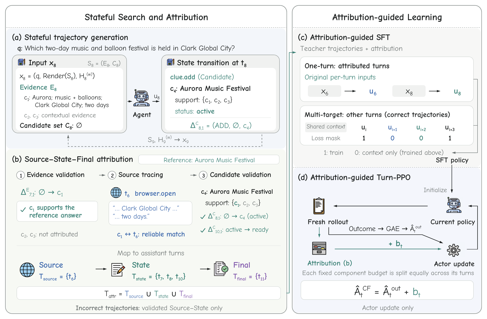

<div align="center">
  <picture>
    <source media="(prefers-color-scheme: dark)"
            srcset="assets/clueflow-logo-light.png">
    <source media="(prefers-color-scheme: light)"
            srcset="assets/clueflow-logo-dark.png">
    
  </picture>
</div>

<p align="center">
  <strong>Learning Long-Horizon Search through Attributed Research-State Transitions</strong>
</p>

<p align="center">
  <a href="https://arxiv.org/abs/2610.25980">
    
  </a>
  <a href="https://huggingface.co/wangyicheng992/ClueFlow-35B">
    
  </a>
  <a href="https://huggingface.co/datasets/wangyicheng992/ClueFlow-SFT">
    
  </a>
</p>

## Overview

**ClueFlow** is a stateful search agent harness that provides a unified research-state interface for **long-horizon inference, trajectory generation, and post-training**.

At inference time, ClueFlow equips language models with browser tools and persistent **Evidence** and **Candidate** states. Agents can accumulate evidence, track competing hypotheses, and revise their research states across extended interactions while operating with bounded context windows.

The same stateful execution interface supports teacher trajectory collection and online reinforcement learning rollouts. ClueFlow records browser actions and structured state transitions, enabling **Source–State–Final attribution** that connects information acquisition, validated research progress, and final-answer decisions.

These attributed transitions provide a shared foundation for **SFT data construction and reinforcement learning credit assignment**, including the recovery of useful intermediate progress from unsuccessful trajectories.

<p align="center">
  <a href="assets/clueflow-method-overview.pdf">
    
  </a>
</p>

## Core Capabilities

**Stateful Search Inference.** Execute long-horizon search with persistent research states, structured tool operations, and bounded interaction histories.

**Trajectory Generation.** Collect reproducible search trajectories with browser observations, state transitions, and action provenance.

**Transition Attribution.** Validate Evidence and Candidate updates and trace supported research progress back to the browser actions that produced it.

**Post-Training Support.** Construct attribution-guided SFT examples and turn-level credit signals for PPO using a shared trajectory representation.

## Release Status

The ClueFlow paper is available on [arXiv](https://arxiv.org/abs/2610.25980). The source code and additional research artifacts will be released soon. Please stay tuned for updates.

## Citation

If you find ClueFlow useful in your research, please consider citing our paper:

```bibtex
@misc{wang2026clueflow,
  title={ClueFlow: Learning Long-Horizon Search through Attributed Research-State Transitions},
  author={Yicheng Wang and Wentao Tan and Yidan Huang and Yifei Liu and Qiong Cao},
  year={2026},
  eprint={2610.25980},
  archivePrefix={arXiv},
  primaryClass={cs.AI},
  url={https://arxiv.org/abs/2610.25980}
}
```

## Acknowledgements

We thank [GLM-5](https://github.com/zai-org/GLM-5),
[Qwen3 (QwenLM)](https://github.com/QwenLM/Qwen3),
[REDSearcher](https://github.com/RedSearchAgent/REDSearcher),
[OpenResearcher](https://github.com/TIGER-AI-Lab/OpenResearcher),
[MS-SWIFT](https://github.com/modelscope/ms-swift), and
[slime](https://github.com/THUDM/slime) for their open-source research, models,
datasets, and training infrastructure.
